## Вступление

Проект сложный, на внимательность. И местами очень странный.

Основная странность - ТЗ списанное с СРР версии без учета плюсов и минусов языка.

Поентому надо сразу сказать, что понравилось, а с чем мы в корне не согласны.

* Давайте всё же примем, что статических библиотек, в том смысле, в котором мы к ним привыкли с С и С++ в Питоне нет, а есть модули, т.е. просто библиотеки. \
Сама суть питона - интерпретация интерпретируемого кода интерпретатором.

* А вот что нам понравилось, хотя тоже с оговорками - требование использовать в некоторых функциях самописные очередь и стек.\
И тут можно быстренько накидать что-то простое на том же Питоне, но они сами нам дают подсказку использовать библиотеку и плюсовых контейнеров.
\
И вот тут получаем следующее - Питон не работает с компилированными статическими библитеками на С и С++, но вполне можно подключить библиотеку динамическую.
\
Кто-то может спросить что-то вроде "и что нам енто даст?", "какой смысл?" или "какая разница, если можно на Питончике быстренько набросать?"
\
Да, аргумент. Но фишка заключается в том, что, используя динамические библиотеки мы передаем кусок данных для обработки буквально другой программе, ожидая обратно хорошенько пережеванный ответ. А ни для кого не секрет, что плюсовые приложения самые быстрые, как Ламборгини.
\
И вот тут уже начинает проступать смысл использования, даже в нашем интерпретируемом Питоне, сторонних библиотек.
\
Поентому мы изменим шаблон плюсовой очереди и стека, заточим под интегер, и скомпилим в .so файл. А для работы с ними модуль cppyy. Укажем объявления классов и функций, и загрузим библиотеки.
\
Вроде, можно работать, но нет, есть нюанс. Плюсовая функция pop() удаляет объект из очереди/стека, но не возвращает его.
\
Но не беда, просто сделаем пару Питоновых наследников и подправим функции заодно:
```c
class queue(s21.queue):
    def pop(self):
        res = super().front()
        super().pop()
        return res

class stack(s21.stack):
    def pop(self):
        res = super().top()
        super().pop()
        return res
```

* И последний странный пункт в ТЗ - "class TsmResult(ctypes.Structure)". Вот абсолютно непонятно, зачем нам тут такое. \
Нет, оно было понятно, если бы CLI мы на Сях писали, но нет же, енто не С и С++.
\
Но, ТЗ - есть ТЗ, поентому мы функцию вывода результата решения проблемы коммивояжёра выполним так как просят и будем её использовать.


## Часть 1. Самое простое

Тут мы рассмотрим вполне понятные нормальным людям вещи из ентого проекта - поиск в глубину и ширину, алгоритм Дейкстры, остновное дерево и матрицу стоимости кратчайших путей.

Ко всему мы прикрепили ссылки на источники, описывающие алгоритмы, поентому тут опишем кратко.

### Поиск в ширину и глубину.

Енто мы уже делали в лабиринте.

Причем поиск в глубину - просто интуитивен, приходит в голову сам даже детям. Но с поправкой на интуитивность использования рекурсии.

Ну, т.е. мы приходим в точку, смотрим, куда можем пойти дальше (исключая то, где мы были), идем в первую по списку, а список оставляем на точке. На следующей точке повторяем то же самое. Если зашли в тупик, то возвращаемся на точку назад, берем список и вычеркиваем направление с тупиком.

Но у рекурсии есть масса недостатков. Поентому можно от нее отказаться. Но есть кое-что, что может сэмуллировать рекурсию - стек. Последним в список записан - первым из него достается.

Т.е. приходим на точку, смотрим куда можно идти дальше и скидываем в стек. Потом берем верхнюю запись.

А можно вместо стека использовать очередь. Тогда, вроде, всё то же самое, но для выбора следующего объекта обследования брать мы будем самую старую запись.\
Так мы получаем поиск в ширину.

Визуально разница в том, что при поску в глубину мы сразу убегаем в самый дальний угол, а при поиске в ширину сначала исследуем всё вокруг себя.

В качестве наглядного примера как оно видится — вот картинка с инета:

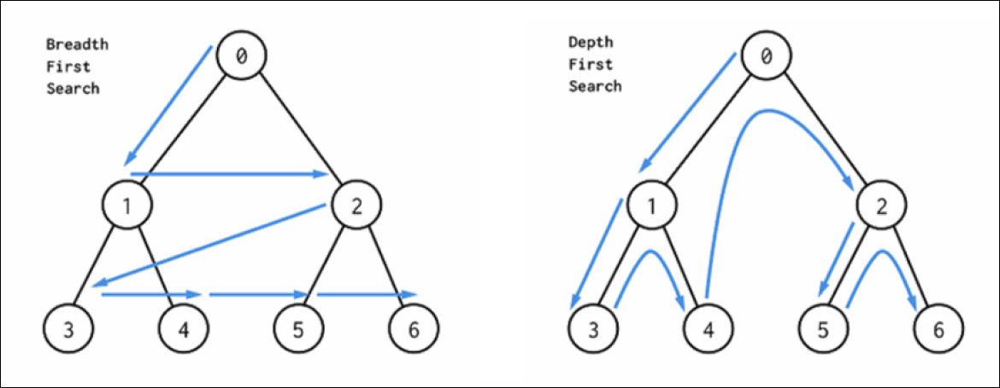

Однако, как уже было сказано, мы такое делали в лабиринте, поентому — вот как оно применимо в графе-лабиринте:

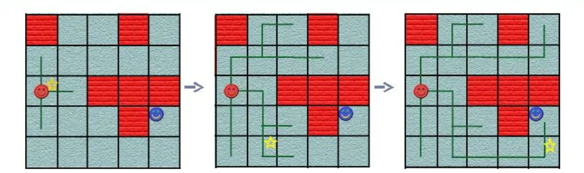

Как видно, при поиске в ширину мы сперва изучили ближайшие клетки, потом слегка увеличили радиус обзора, потом еще чутка, и так прошли всё.

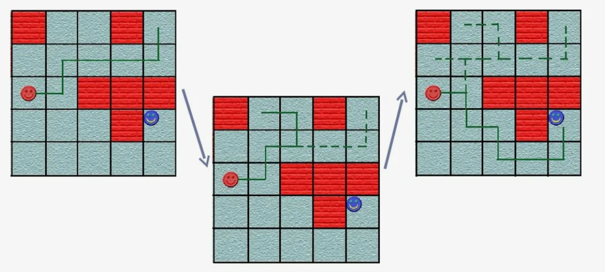

А поиск в глубину может увести в самые дальне дали...

### Алгоритм Дейкстры.

А что, если нам надо не просто вычислить кратчайший путь по количеству посещенных точек, а если за проход от точки к точке нам проходится платить?


Тогда, лучшей путёй может оказаться не та, которая меньше по количеству переходов. Ведь лучше пройти лишний километр, чем лишиться печени.

Тогда, для прокладывания пути/первоначального обследования мы можем использовать тот же поиск в ширину, но переходы дешевле класть вниз нашей очереди, а подороже откладывать на потом.

Решение есть (по крайней мере в Питоне) - приоритетная очередь. Ну, т.е. натурально, всё просто - привинчиваем к поиску в ширину приоритетную очередь и получаем вполне адекватный обход местности с учетом цены. Просто не суемся, откладываем в конец то, что дороже. А когда нашли искомую точку можем быть уверены, что оно дешевле, оптимально. Тут ключевое - не короче, а дешевле.

Но вернемся к самому заданию и посмотрим ТЗ. В ентом замечательном файле написано так "Функция принимает на вход номера двух вершин и возвращает численный результат, равный наименьшему расстоянию между ними." Видите где-нибудь, что-то про сам путь?

Т.е. человек хочет пройти от точки А к точке Б кратчайшим/самым дешевым путём, а ему вместо пути говорят сколько будет стоить минимальный путь, а дальше сам выкручивайся.

Поентому мы сделаем 2 функции. Первая будет согласно ТЗ. Она будет технически присутствовать. А использовать будем другую, которая и путь вернёт.

### Алгоритм Флойда — Уоршелла

Такой алгоритм, в простом его виде, не даст нам самих путей между всеми точками, но переделает матрицу смежности так, что мы будем видеть расчёт кратчайших расстояний между всеми ними.

Вот картинка из Вики:

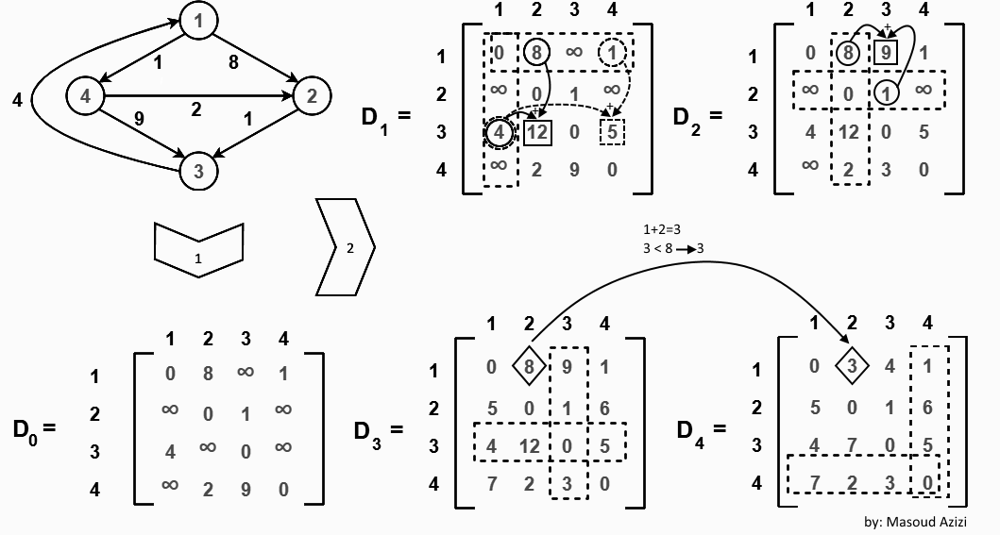

Просто проходим по парам строка-столбец и сравниваем сумму строки-столбца и имеющегося в ячейке. Если новое значение меньше, то его и записываем.

Гениально и просто.

### Остовное дерево

Иногда, имеет смысл найти не кратчайший маршрут из точки в точку, а возможность дешевле всего поспасть из любой точки в любую точку по понятному маршруту.

Тут приходит на помощь остовное дерево - т.е. какой-то маршрут, в котором нет петель. Таких маршрутов в графе может быть очень много, но они отличаются разной стоимостью. И самый дешевый из них называется минимальное остовное дерево.

Енто весьма важная штука, ведь найти кратчайший маршрут из одной точки в другую если вам надо передать один пакет, дело хоть и затратное, но весьма обоснованное.\
А если вам надо на постоянной основе гонять курьеров по пачке возможных конечных пунктов?

Тогла лучше, чтоб в имеющейся карте не было петель. Тогда возможный маршрут будет один и будет очевиден.

Такой принцип, например, используется в сетях. Почитайте про Spanning Tree Protocol

Вот ссыль - https://en.wikipedia.org/wiki/Spanning_Tree_Protocol

Он соединяет оконечные устройства в сети, гарантируя вполне приемлемый по оптимальности путь без петель, которые в сети могут привести к не самым веселым последствиям.

Алгоритм Прима для нахождения минимального остовного дерева предполагает разбор взвешенного связного неориентированного графа.

По сути, он тоже прост - начинаем с одной точки, смотрим пути, и добавляем в дерево тот, что дешевле.

Потом смотрим возможные пути (возможные - где еще не были, чтоб петель не образовалось) с двух точек, и снова добавляем в дерево самый дешевый.

И так, итерация за итерацией, мы смотрим возможные пути до туда, где мы не были со всех точек, где мы уже были и выбираем самый дешевый.

## Часть 2. Самое упоротое. Задача коммивояжёра

Вот тут начинается наркомания. Хотя нет, не тут.

Первое, что узнаем, знакомясь с задачей коммивояжёра, что можно её решить точно, но точно ентого делать не стоит. По крайней мере для серьезных случаев.
Но про такие способы всё равно надо упомянуть.

Но вот что несколько выносит мозг, что у нас есть алгоритмы выдающие приблизительный, иногда очень приблизительный, а иногда и не приблизительный ответ, которым нам полагается довольствоваться.

### Точные методы. Перебор

Первая метода - грубая сила. Просто составляем все возможные пути, которые по условию задачи делают круг, не проходя в одну вершину дважды, считаем их стоимости и выбираем самое дешевое.

Ну, енто уже перебор.

Говорят, что довольно быстро, где-то на 20 вершинах, таких путей будет не просто дофига, а дофига в степени дофига.

Мы енту методу опишем, но, поскольку использовать её бессмысленно, то внесем в классический вид несколько изменений:
1. Пути будем перебирать в глубину и рекурсией.
2. Как только найдем первый полный путь, запишем его.
3. Если при исследовании следующего маршрута мы заметим, что следующий шаг длиннее имеющегося лучшего пути, то енот шаг делать не будем.
4. Если же новый полный путь дешевле записанного, то, соответственно он и станет текущим лучшим путём.

Так мы немного выиграем в вычислениях. Но очень немного. Более того, замечено, что на больших графах алгоритм сбоит. Видимо, всё же рекурсия.

### Точные методы. Алгоритм Беллмана-Хелда-Карпа

Тоже точный метод, и работает быстрее перебора, строится он на том, что сперва строит таблицу 2^количество вершин на количество вершин.

Причем указание строки енто множество вершин, где мы уже были, а указание столбца - следующий шаг. Типа array[{1, 2, 3, 4}][5]

Тут помогает использование битовой маски для обозначения строк, где положительный бит указывает на номер вершины. Например, число 9 (1001) говорит о том, что мы были в первой и четвертой вершинах.

Проходя таблицу, записываем стоимость пройденных путей. А в последней строке выбираем самое меньшее значение (с учетом возврата в первую вершину).

Работает долго. Но быстрее, чем перебор.

### Неточный, но быстрый метод. Метод ближайшего соседа

Вот тут самый понятный вариант.

Он является одним их так называемых "жадных алгоритмов".

И действительно, суть в том, что берем вершину, ищем соседей, и выбираем самый дешевый путь. Потом от него тоже ищем соседей, исключая тех, где уже были, и тоже выбираем самый дешевый путь. Повторять, пока не сделаем круг.

Такой алгоритм очень быстрый, но ни разу не точный. Поентому, может иметь смысл пройтись по разу начиная с каждой вершины графа и выбрать самый дешевый маршрут.

### Неточный, но точный. Муравьиный алгоритм

Вот тут начинаем немного закидываться вероятностями. 

Суть вот в чем. Представляем наш граф как муравьиные тропы и, как ни странно, пускаем муравьёв.

Муравьи, двигаясь с установкой, что нельзя два раза посещать одну и ту же точку, на распутье с некоторой вероятностью выбирают из имеющихся маршрутов.

Когда муравьи идут, то оставляют за собой запах феромонов. Причем, чем длиннее получился кружок, то тем меньше феромонов по нему размазалось.

После того, как одна группа муравьев справилась с заданием, то идет следующая группа, потом следующая, потом следующая, пока последующие группы не будут просто ходить проторенной дорогой уже не выбирая пути, а просто следуя по пути феромонов. Вот такой путь и считаем оптимальным.

Мне кажется, что алгоритм придумали примерно так:

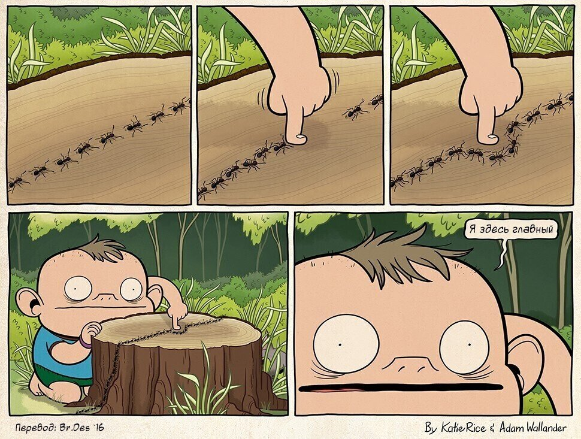

Но, если серьезно, то алгоритм с кучей настроек. Причем оптимальность/быстродействие/точность зависят еще и от самих графов, которые нам надо решить.

Первое - количество муравьёв на круг. Чаще всего по одному на вершину.
Второе - скорость выветривания феромонов. Слишком быстро выветриваются - каждый круг опять по новой, слишком медленно - популярным станет не обязательно короткий маршрут.
Третье - коэффициенты выбора пути по феромону или длине следующего шага. Ну, тут понятно, что если ориентироваться чисто по феромонам, то короткого пути нам не видать, а если не брать в серьезный расчёт феромоны, то енто уже метод ближайшего соседа.

Удивительно, но если мы проведем некоторое количество таких вычислений (100, 200, 500, 1000), то можно довольно быстро получить очень точный ответ даже на больших графах. Пожалуй, енто наш самый любимый алгоритм.

### Наркомания. Метод имитации отжига

Следующая группа алгоритмов - методы Монте-Карло.

На сцену выходит Его Величество Случай. Натурально, кидаем кубик, орёл или решка, как фишка ляжет. Но, казино всегда выигрывает.

С такой точностью я могу и свой метод предложить. Назовем его "метод авгура". Гадание пути по внутренностям животных. Результат будет примерно тот же.

Зато, что надо признать, работает очень быстро.

Но возьмем для реализации относительно безобидный метод имитации отжига. 

Суть в следующем, находим полный путь. Любой.

Потом рандомно меняем две позиции в пути и пересчитываем его. Если получился меньше, то вот он наш фаворит, снижаем температуру отжига и работаем с новым фаворитом.

Если же стоимость пути претендента больше, то даём ему шанс. С учетом текущей температуры, вычисляем наши шансы принятия или непринятия более длинного пути в работу, и запускаем еще один рандом.

Если не повезло, то работаем со старым, но более коротким путем. Повезло, принимаем в работу более длинный. Но температура в любом случае снижается при каждой итерации.

И по итогу, у нас получается вообще "шикарный" путь.

Чтоб получить хоть сколько-то приемлемый результат надо делать очень много запусков. Благо, как писалось выше, работает оно очень быстро.

### Как-бы сравнение, типа аналитика

Давайте сгенерируем пачку полносвязных ненаправленных графов разной размерности и потестим наши алгоритмы, попробуем сделать некое сравнение.

ПРИМЕЧАНИЕ. Цифры затраченного времени следует воспринимать не в абсолюте, а относительно друг друга. Факторов множество: ресурсы памяти, процессора, да и язык влияет.

Сначала идут алгоритмы, которые не имеет смысла запускать несколько раз, просто потому, что результат будет всегда одинаковый.

1. Перебор, он же Brute force:

|verticies|time|path weight|path|
| :--- | :--- | :--- | :--- |
|4|0,000034|127|1, 2, 4, 3, 1|
|8|0,002074|201|1, 3, 2, 6, 4, 5, 7, 8, 1|
|10|0,014365|181|1, 5, 9, 10, 3, 7, 6, 2, 8, 4, 1|
|12|0,250253|250|1, 9, 4, 6, 8, 10, 11, 7, 3, 2, 5, 12, 1|
|14|4,076166|224|1, 11, 10, 7, 14, 6, 13, 12, 5, 4, 2, 8, 9, 3, 1|
|16|141,69197|283|1, 4, 13, 3, 9, 12, 2, 16, 15, 5, 11, 7, 10, 14, 6, 8, 1|
|18|223,278807|237|1, 14, 3, 6, 18, 8, 12, 2, 10, 13, 17, 9, 4, 15, 11, 7, 5, 16, 1|
|20|8262,821175|285|1, 20, 7, 17, 8, 4, 10, 11, 3, 15, 6, 14, 18, 2, 13, 5, 9, 12, 19, 16, 1|

Прошло 8 тестов и на графе в 20 вершин было решено остановиться, ибо не так уж нам и надо.

2. Алгоритм Хелда-Карпа:

|verticies|time|path weight|path|
| :--- | :--- | :--- | :--- |
|4|0,000055|127|1, 3, 4, 2, 1|
|8|0,001166|201|1, 8, 7, 5, 4, 6, 2, 3, 1|
|10|0,008919|181|1, 5, 9, 10, 3, 7, 6, 2, 8, 4, 1|
|12|0,042927|250|1, 12, 5, 2, 3, 7, 11, 10, 8, 6, 4, 9, 1|
|14|0,243442|224|1, 11, 10, 7, 14, 6, 13, 12, 5, 4, 2, 8, 9, 3, 1|
|16|1,342535|279|1, 8, 6, 14, 13, 3, 9, 5, 11, 7, 10, 15, 16, 2, 12, 4, 1|
|18|6,246287|231|1, 14, 3, 8, 18, 6, 4, 15, 16, 9, 17, 13, 10, 2, 12, 11, 5, 7, 1|
|20|30,758935|285|1, 20, 7, 17, 8, 4, 10, 11, 3, 15, 6, 14, 18, 2, 13, 5, 9, 12, 19, 16, 1|

Как видно, тут тоже остановались на 20 веришнах, но только потому, что дальше оно вешает систему требуя много ресурсов на свою таблицу.

Вероятно, можно сделать выделение ресурсов постепенным, но проект немного не о том. Хотя об ентом мы еще вспомним в конце анализа.

Также видно, что такой алгоритм работает сильно быстрее перебора, хоть и относится к точным методам.

ПРИМЕЧАНИЕ. Можно заметить, что показания первых двух алгоритмов немного разняться. Полагаю, енто является следствием реализации алгоритмя перебора. Не используйте рекурсии.

Ну и динамика роста затрат времени (у перебора не включена последняя отметка, так как она улетает в космос):

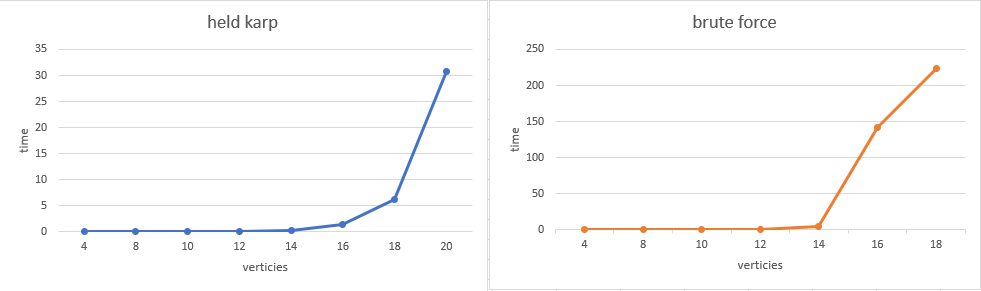

3. Ближайший сосед:

Метод не точный, но результат всегда один.

|verticies|time|path weight|path|
| :--- | :--- | :--- | :--- |
|4|0,000034|127|1, 2, 4, 3, 1|
|8|0,000135|206|7, 5, 1, 3, 2, 6, 4, 8, 7|
|10|0,000242|181|2, 8, 4, 1, 5, 9, 10, 3, 7, 6, 2|
|12|0,000395|298|6, 8, 10, 1, 3, 2, 5, 12, 11, 7, 9, 4, 6|
|14|0,00061|288|9, 7, 14, 6, 12, 10, 11, 1, 3, 8, 2, 4, 5, 13, 9|
|16|0,000898|297|12, 2, 16, 3, 13, 4, 1, 8, 6, 14, 10, 7, 11, 5, 15, 9, 12|
|18|0,001605|294|7, 11, 5, 17, 13, 10, 2, 12, 8, 3, 14, 1, 16, 9, 4, 15, 18, 6, 7|
|20|0,002968|364|20, 7, 10, 4, 8, 3, 15, 6, 14, 18, 2, 13, 16, 1, 19, 12, 9, 5, 17, 11, 20|
|22|0,004017|299|15, 3, 16, 14, 10, 12, 8, 17, 7, 1, 11, 6, 5, 13, 18, 20, 4, 19, 22, 21, 9, 2, 15|
|24|0,004778|368|3, 23, 2, 14, 1, 24, 10, 15, 4, 8, 9, 12, 22, 5, 20, 18, 13, 16, 6, 21, 7, 17, 11, 19, 3|
|26|0,003701|325|13, 22, 18, 7, 8, 9, 14, 19, 16, 23, 1, 6, 12, 2, 4, 3, 26, 10, 15, 5, 24, 11, 17, 25, 21, 20, 13|
|28|0,005124|433|5, 1, 8, 26, 18, 11, 6, 10, 24, 16, 23, 4, 15, 21, 27, 20, 19, 7, 22, 9, 25, 17, 3, 12, 2, 13, 14, 28, 5|
|30|0,005856|401|4, 1, 17, 9, 7, 2, 5, 27, 19, 13, 15, 30, 29, 22, 25, 16, 28, 18, 14, 8, 6, 20, 26, 24, 12, 23, 3, 10, 11, 21, 4|

Динамика роста затрат времени:

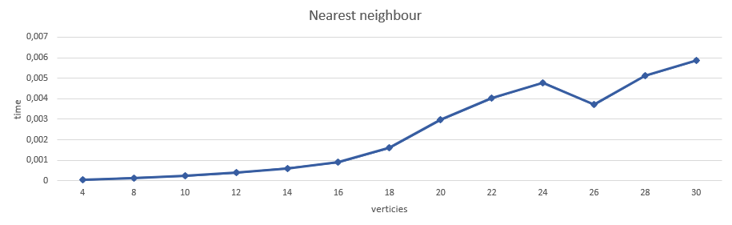

4. Муравьиный тест:

Тут уже поинтереснее. Поскольку мы уже играем с рандомом, то имеет смысл прогонять тест не один раз, а несколько, выбирая каждый раз лучший итог:

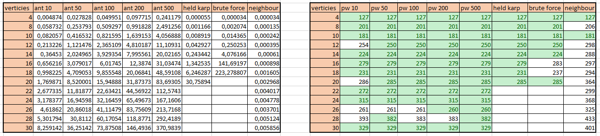

Видно некоторую кореляцию между количеством запусков и точностью, хоть и не полную. Также видно, что при одинаковых параметрах время выполения растет линейно в зависимости от количества запусков, и линейно-логарифмически в зависимости от количества вершин. Считаем енто неплохим результатом с учетом точности решений.

Вот график времени всех запусков, включая предыдущие алгоритмы:

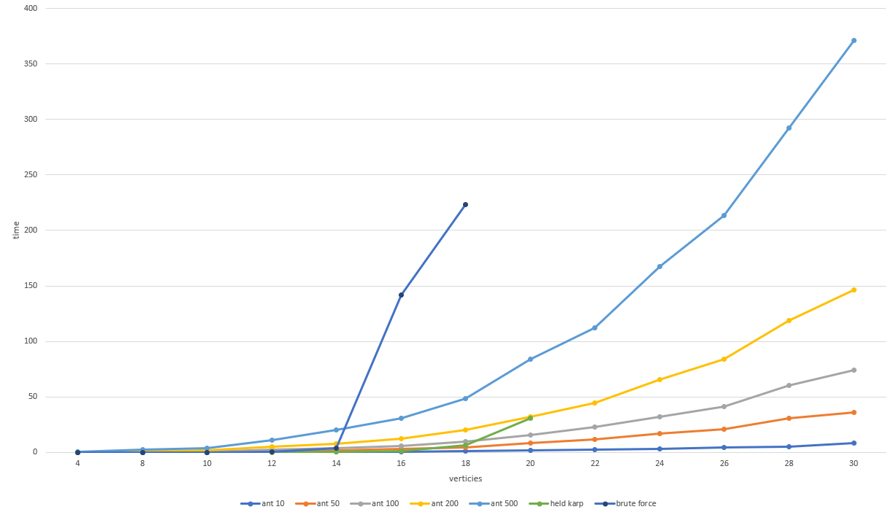

5. Полное рандомное безумие метода имитации отжига:

Ну а тут полный улёт. Нет, реально, скорости бешеные. Сравнивать их между собой не имеет никакого смысла, как и сравнивать с другими алгоритмами. Но вот результаты...

Можно было бы решить, что, как и с муравьями, количество запусков решит проблему. Но нет, рандом - он и есть рандом:

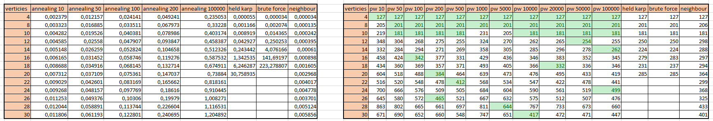

### Итоги сравнений

Ну и сводная таблица решений, где выделили лучшие варианты каждого алгоритма:

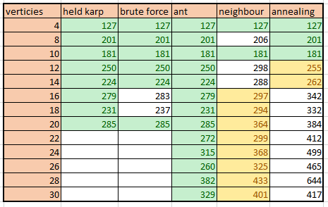

Видно, что метод отжига натурально гадает. Искать жадным алгоритмом можно, если лень думать, но все же не самый лучший путь получается.

Но, что хочется сказать. Такой анализ не совсем корректный, так как случаи бывают разные: количество вершин, направление, стоимость расчетов и стоимость ошибки.

Надо брать конкретную массу задач, тип графа и условия, в которых придется работать, и уже исходя из ентого подбирать алгоритм. 

Более того, тот же муравьиный алгоритм имеет кучу настроек (мы использовали стандартные, базовые), и с разными графами они ведут себя сильно по разному.

Ну, а в целом, если небольшой граф, то лучше алгоритм Хелда-Карпа, так спишь спокойнее. А в других случаях запускаем муравьёв.

Также прилагаем к проекту все таблицы использованные при анализе.

## Часть 3. Сборка

Ну и в конце несколько слов о том, как мы будем енто собирать.

Применим методу со сборкой отдельных пакетов и упаковкой их в устанавливаемые с помощью pip архивы.

Что для ентого надо:
1. Организовать дерево зависимостей.
2. В каждом пакете настроить файл pyproject.toml с указанием зависимостей.
3. Сделать простую точку запуска.

Зависимости будут следующие:
Пакет s21_graph -> пакет s21_graph_algorithms -> s21_navigator_cli -> app.py

В s21_graph файл pyproject.toml будет такой:
```
[tool.poetry]
name = "s21_graph"
version = "0.0.1"
description = "s21_graph"
authors = [ "name = stilwool-suannefu email = elijah@mcshine.ru" ]

[tool.poetry.dependencies]
graphviz = "^0.21"

[build-system]
requires = ["poetry-core>=1.0.0"]
build-backend = "poetry.core.masonry.api"
```

Из зависимостей только graphviz (хотя можно сделать и без него).

В s21_graph_algorithms файл pyproject.toml будет такой:
```
[tool.poetry]
name = "s21_graph_algorithms"
version = "0.1.0"
description = "s21_graph_algorithms"
authors = [ "name = stilwool-suannefu email = elijah@mcshine.ru" ]

[tool.poetry.dependencies]
cppyy = "3.5.0"
s21_graph = "0.0.1"

[build-system]
requires = ["poetry-core>=1.0.0"]
build-backend = "poetry.core.masonry.api"
```

Как видим, для своей работы он подтянет еще и s21_graph.

Ну а пакет s21_navigator_cli будет ожидать установленным оба предыдущих пакета.

App.py будет до безобразия простой:
```python
from s21_navigator_cli.cli import S21NavigatorCLI

if __name__ == "__main__":
    main_obj = S21NavigatorCLI()
    main_obj.main_loop()
```

Теперь, как на собрать пакет из пакетов с пакетами. Просто из каталога с pyproject.toml запускаем:
```
python -m build
```

В папке dist у нас появляется архив и устанавливаемый архив.

Теперь над надо только копирнуть его в инет, или установить с локального места:
```
pip install --find-links=./ s21_navigator_cli
```
